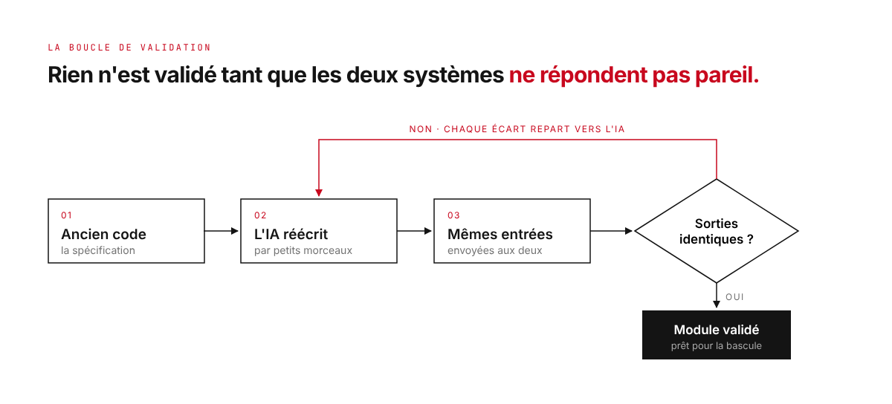

:lang: fr

Votre application historique fonctionne. Elle porte des années de règles métier, et personne n'a envie d'y toucher. C'est justement le problème : la techno n'est plus maintenue, les personnes qui la connaissent s'en vont, et chaque petite évolution prend des semaines.

Pendant longtemps, la réponse raisonnable était de ne rien faire. Une refonte coûtait trop cher, prenait trop de temps et faisait courir trop de risques. Ce calcul est en train de changer : *des refontes jugées jusqu'ici trop lourdes pour être entreprises deviennent faisables avec l'IA*, à condition de prouver que le résultat est juste.

Cet article résume notre approche. La méthode complète, les exemples et leurs limites sont détaillés dans notre livre blanc *« Moderniser un système legacy avec l'IA sans rien casser »*.

++++

<a class="btn btn__primary" href="livre-blanc-modernisation-legacy-ia.pdf" download style="display:inline-flex;font-size:0.95rem;letter-spacing:0.16em;height:56px">Télécharger le livre blanc (PDF)</a>

++++

== Des chantiers qu'on n'osait pas lancer

Ces deux dernières années, plusieurs grandes équipes ont publié des chantiers qu'elles n'auraient sans doute pas lancés sans l'IA.

* *Amazon* a fait passer ses applications Java à Java 17 avec Amazon Q. Selon Andy Jassy, une mise à niveau est passée d'environ 50 jours-développeur à quelques heures, soit environ 4 500 années-développeur économisées, et plus de la moitié des systèmes Java de production ont été migrés en six mois (https://the-decoder.com/amazons-ai-assistant-saves-4500-years-of-development-time-ceo-andy-jassy-says/[The Decoder]).
* *Airbnb* a migré 3 500 fichiers de tests en six semaines, un travail estimé à un an et demi à la main ; 75 % des fichiers l'ont été en quatre heures (https://medium.com/airbnb-engineering/accelerating-large-scale-test-migration-with-llms-9565c208023b[Airbnb Tech Blog]).
* *GitHub* a réécrit le runtime de Copilot de TypeScript en Rust : plus de 800 000 lignes remplacées en 14,5 semaines, via 128 pull requests, sans arrêter les livraisons (https://infoq.com/news/2026/10/github-copilot-rust-migration[InfoQ]).
* *Insider* a réécrit en Go, en dix jours, un service Scala de huit ans, et divisé par deux son coût de calcul (https://medium.com/insiderengineering/we-rewrote-an-8-years-old-scala-service-in-go-in-10-days-0f56cef407c6[Insider Engineering]).
* *Cloudflare* a réimplémenté Next.js en une semaine environ, avec un seul ingénieur (https://infoq.com/news/2026/03/cloudflare-vinext-experimental[InfoQ]).

Deux nuances s'imposent. Le cas Cloudflare n'est pas du legacy, et Vercel a ensuite trouvé des failles de sécurité dans cette réimplémentation. Microsoft vise, de son côté, à remplacer son code C et C++ par du Rust d'ici 2030 avec l'aide de l'IA, mais c'est un objectif : son auteur a précisé que Windows n'est pas en train d'être réécrit.

Ce qui se généralise n'est ni le langage ni la vitesse. C'est que le coût d'une refonte s'effondre, et qu'il devient souvent inférieur à celui du statu quo.

== Le vrai sujet : prouver que rien ne change

Demander à une IA de « convertir ce code » donne du code qui a l'air juste. Ce qu'il faut, c'est du code qui est juste. Les équipes qui réussissent partent toutes du même principe : l'ancien code est la spécification, les cas réels sont le test, et rien n'est terminé tant que les deux systèmes ne répondent pas exactement pareil.

Cette boucle a un effet que l'on sous-estime : elle fait remonter les règles oubliées. Chez Insider, la comparaison a révélé quatre comportements de l'ancien service que personne dans l'équipe ne connaissait. Aucune relecture ne les aurait trouvés.

== L'IA ne fait pas tout le travail

L'IA écrit vite. Elle ne sait pas, seule, si ce qu'elle a écrit est bon. Chez Lunatech, *chaque fonction, chaque feature est relue et validée par un développeur* qui a l'œil et le vécu pour juger ce qui est bon ou mauvais : une règle métier mal comprise, un cas limite oublié, une performance qui se dégrade, un code juste mais impossible à maintenir.

Les chiffres d'Amazon le rappellent : 79 % des revues de code générées ont été livrées sans modification. Autrement dit, une sur cinq a dû être corrigée par quelqu'un qui savait quoi regarder. C'est ce regard que nous apportons sur chaque projet.

== Notre approche chez Lunatech

L'IA fait le gros du travail, nos experts décident, et vous validez chaque étape.

. *Comprendre* : l'IA lit tout l'ancien code et nous reconstituons ce que fait vraiment votre système.
. *Décider* : architecture, cloud, mobile et langage cible, choisis avec vous.
. *Construire* : module par module, chaque morceau comparé à l'ancien sur vos vrais cas (fin de mois, cas limites, anomalies connues) et relu par un développeur.
. *Basculer* : votre ancien système reste actif pendant toute la migration, et la mise en service a lieu quand tous les tests de référence passent, avec un plan de repli préparé avant le jour J.
. *Transmettre* : code et tests de référence remis, vos équipes formées via WeLearn.

Vos systèmes ne ressemblent pas à un service bien délimité qui reçoit des millions de requêtes : ils ont des données, des traitements par lots, des écrans, des cas rares. C'est pour cela que vos métiers choisissent les scénarios de test, en plus du trafic réel quand il existe.

Pour le détail de chaque phase, voir aussi notre article https://blog.lunatech.com/posts/2026-05-26-legacy-modernization-with-ai[Legacy Modernization with AI: A Battle-Tested Methodology] (en anglais).

== Par où commencer

La question n'est plus « peut-on se permettre de moderniser ? » mais « combien coûte le statu quo ? ». Pour y répondre avec des faits, nous proposons un diagnostic à prix fixe, en une à deux semaines. Vous repartez avec l'inventaire fonctionnel de votre système, le registre des risques, une feuille de route vers le cloud et le mobile, et une base chiffrée pour mesurer les gains.

Pour aller plus loin, le livre blanc détaille la méthode, les exemples et leurs limites, et ce que demande un vrai système legacy.

++++

<a class="btn btn__primary" href="livre-blanc-modernisation-legacy-ia.pdf" download style="display:inline-flex;font-size:0.95rem;letter-spacing:0.16em;height:56px">Télécharger le livre blanc (PDF)</a>

++++

Une question sur votre système ? Écrivez à Maxime Soulas (mailto:maxime.soulas@lunatech.fr[maxime.soulas@lunatech.fr]).
